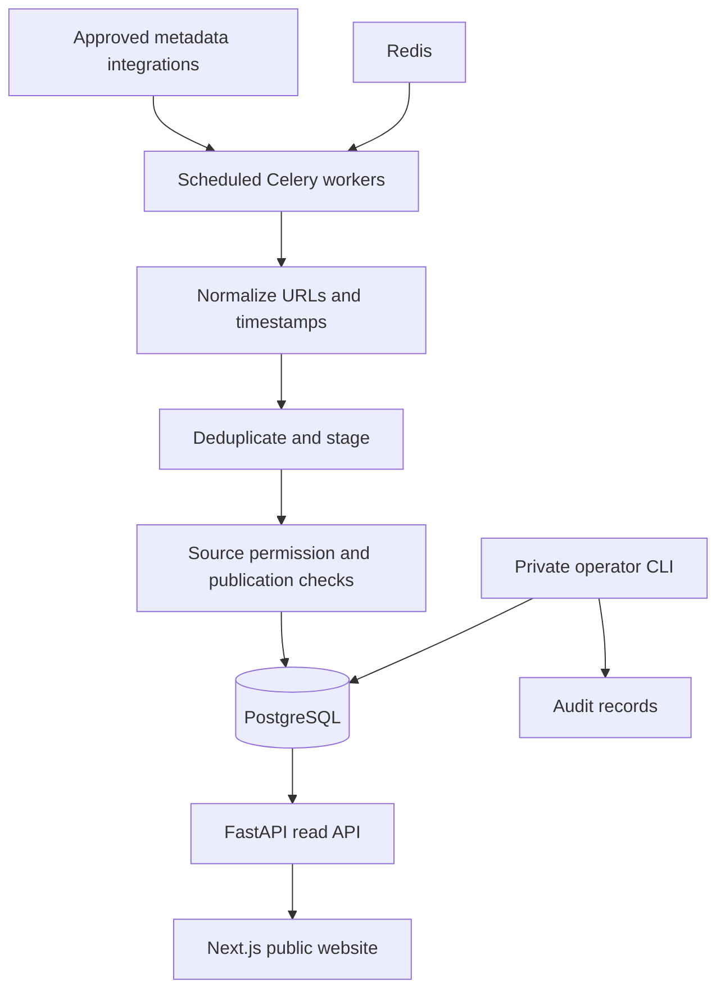

# GlobalDesk public news platform — architecture and delivery plan

Status: 16 October 2026. This document turns the supplied blueprint into an implementation plan for this repository. The current application is a local demonstration, not a launched live news service. Planning figures and publisher terms in the supplied text have not been independently verified and are not operational configuration.

## Product and first release

English public news discovery with World, Business, Economy, Politics, Technology and Marketing. Readers browse public source-linked listings, combine archive filters and read a dated daily digest. No reader account is required. Markets, Law & Regulation and Special Reports are expansion sections, not populated placeholder pages.

## Architecture



The deployed topology retains Python and PostgreSQL; it is not a static-only hosting application. Run the website behind HTTPS/CDN, the API behind a reverse proxy, and PostgreSQL/Redis on private networks. The frontend fetches the API server-side through INTERNAL_API_URL; database credentials never enter the browser. Keep scheduled workers separate from HTTP processes. SQLite is a local verification option, not evidence of a tested PostgreSQL deployment.

## Implemented modules

| Module | Current implementation |
| --- | --- |
| Reader website | Homepage, six sections, story detail, source listings, About, search/archive and dated briefings |
| Search | Keyword, category, exact publisher domain, country/region, language, UTC date interval, pagination |
| Daily briefing | Up to three latest public listings per section per UTC day, with archive links; no generated prose |
| Ingestion | Optional GDELT metadata adapter, canonical URL normalization, duplicate URL protection, pending staging |
| Scheduling | Celery/Redis Compose services; discovery disabled by default |
| Permissions | Source status and metadata permission checked in public reads; AI permission separate and inactive |
| Editorial controls | Private source approval, source blocking, story withdrawal and operator-attributed database audit log |
| Persistence | Sources, permissions, categories, articles, audit logs; Alembic migrations |
| Packaging | Docker configuration, Windows launcher, npm lockfile, local tests |

## Data model and next migrations

Current: sources 1:1 source_permissions; sources 1:N articles; categories 1:N articles; audit_logs record approvals and moderation. Story identity is the article slug. The current `summary` field contains original demo descriptions; GDELT records have no generated summary.

Add the following in separate, reversible migrations as the related feature ships:

1. Source configurations: feed/API URL, enabled state, polling interval, last success, error count; permission expiry, retention period and evidence reference. Enforce expiry at read time and ingestion time.
2. Job runs: integration, attempt, started/completed time, counts, failure category and next retry. Retain error details without API keys or article bodies.
3. Events and event_articles: event identity and article membership, match confidence and reviewer decision. Similarity is a candidate match, not a claim that coverage is identical.
4. Summaries and summary_sources: generated text, exact permitted inputs, model/version, review state, citations, generation time and correction history. Require AI processing rights before sending any material to a model; invalidate outputs when source permissions change.
5. Editor identities and roles: authenticated operators with review/publish privileges. The CLI actor field is a recorded assertion, not identity verification.
6. Optional subscriptions and preferences only when reader accounts/newsletters are implemented.

## API contract

- GET /health
- GET /api/v1/categories
- GET /api/v1/sources — public sources only
- GET /api/v1/filters — public countries/regions and languages only
- GET /api/v1/news and /api/v1/search — q, category, source, country, language, date_from, date_to, page, page_size
- GET /api/v1/news/{slug} — public article detail, 404 when unavailable
- GET /api/v1/briefings/daily?day=YYYY-MM-DD — UTC daily digest

Dates include the entire selected UTC day. Invalid/reversed date ranges return 422. Search currently uses SQLAlchemy-bound substring queries, not PostgreSQL full-text search or semantic search. Country values preserve adapter metadata; converting source countries to standardized countries/regions is future work.

## Operator workflow

First apply migrations. Private operations require filesystem and database access; do not expose them as unauthenticated web endpoints.

```powershell
cd backend
.\.venv\Scripts\python.exe -m alembic upgrade head
.\.venv\Scripts\python.exe -m app.editorial audit
# Replace placeholders with real targets and reasons; these commands modify publication state.
.\.venv\Scripts\python.exe -m app.editorial withdraw --target ARTICLE_SLUG --actor EDITOR --reason 'Documented correction request'
.\.venv\Scripts\python.exe -m app.editorial block-source --target PUBLISHER_DOMAIN --actor EDITOR --reason 'Documented publisher takedown request'
```

Source approval requires its existing rights attestation CLI plus --actor. Withdrawal has no public restore endpoint. Source blocking hides its listings immediately; reapproval is a separate explicit operator action. Withdrawn stories remain withdrawn on source reapproval. Database administrators can edit audit records, so this is an application audit trail, not tamper-proof evidence.

## Practical sequence and acceptance criteria

| Stage | Work | Exit condition |
| --- | --- | --- |
| Foundation — now | Working repository, six sections, registry, migrations, fixtures | Local build/tests pass and demo status is visible |
| Reader experience — now | Combined filters, archives, dated briefing and source links | Filters compose, invalid dates handled, public gates covered by tests |
| Integration — next | Choose one verified publisher integration; configure access and allowed fields; add bounded RSS/API parsing, retries/backoff, rate limits and job records | Replay fixtures, duplicate and malformed feed tests, successful permitted live run with visible source attribution |
| Operations | Install Docker Desktop; run PostgreSQL migrations and Compose; add API readiness checks and durable monitoring | Full clean install, restart and worker failure tests pass; backup restore demonstrated |
| Editorial web tools | Authenticated dashboard, roles, staged queue, rights evidence/expiry, corrections and audit UI | Unauthorized requests denied; every change attributed; blocked/expired content hidden across all routes |
| Event intelligence | Evaluate clustering on labeled examples; review candidate groups; preserve original sources | Measured false grouping rate and editor split/merge controls |
| Rights-cleared AI | Provider credentials in secret store, explicit permitted inputs, grounded summaries, citations and human review | Denied-rights tests, citation coverage, no automatic publication of unreviewed sensitive claims |
| Public launch | Real approved content, editorial/contact/privacy pages using actual operator details, domain/HTTPS, performance/accessibility/security checks | Production checklist complete; demo records removed before enabling indexing |
| Expansion | Extra categories, countries, languages and opt-in briefings/alerts | Each integration has rights evidence and failure monitoring; delivery has consent/unsubscribe controls |

Planning cadence: foundation in week 1; integrations weeks 2–3; reader refinements weeks 4–5; clustering/AI week 6 if rights are ready; editorial web tools week 7; operations and launch tests weeks 8–9; expansion weeks 10–12. This is a sequencing estimate, not a committed delivery schedule. Publisher onboarding and infrastructure availability can shift dates.

## Deployment and launch checks

- Obtain actual publisher access and document permitted metadata, AI uses, attribution and renewal dates. Do not enable every named publisher based on this blueprint.
- Configure strong secrets, API limits, reverse-proxy timeouts, HTTPS, private database/queue access and restricted operators.
- Add structured job/error logs, failure notifications, uptime monitoring, freshness checks and disk/queue alarms.
- Back up PostgreSQL and test restoration. Test migrations against PostgreSQL, not only SQLite.
- Verify mobile layouts, keyboard navigation, contrast, loading/error states and source-link behavior in a browser.
- Supply actual editorial ownership, contact, privacy and correction processes; do not invent an operator address.
- Remove fictional data before switching robots indexing on. Add canonical URLs/sitemaps for the final public content model.
- Record current vendor quotations separately once hosting, traffic and licences are chosen. No paid service has been purchased or external alert configured by this project.

## Remaining limitations

No authenticated administrator dashboard, live publisher integration approved/enabled, AI summary generation, event clustering, alert delivery, newsletter delivery, account system, production deployment or browser visual verification is claimed. Existing scheduled ingestion has not been exercised with Redis/Celery here. The current daily briefing is on-demand and does not send email or promise morning/evening delivery.


## 17 October 2026 update

Entertainment & Culture expansion is integrated with the existing reader/editorial increment. Fourteen sections are now supported. See ../COMPLETION_STATUS.md for current verification and outstanding roadmap work.
